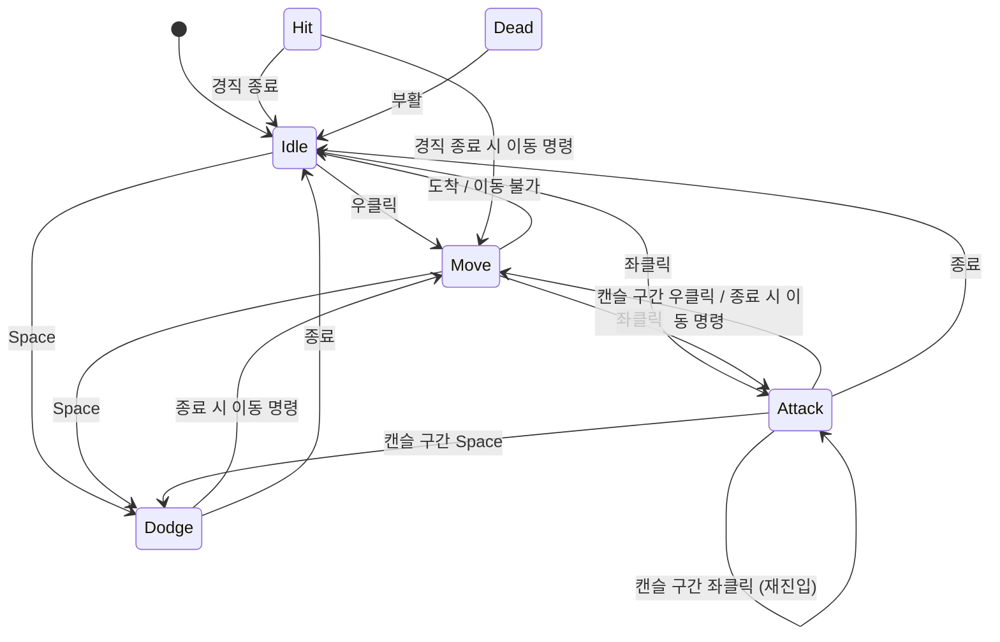

# 플레이어 행동로직 개발 기록

> 플레이어 행동로직(FSM)이 지금 구조가 되기까지의 과정과, 각 결정의 이유를 정리한 문서입니다.
> - **Part 1**: 시간순 개발 기록 (무엇이 문제였고, 어떻게 바꿨는지)
> - **Part 2**: 주제별 정리 (현재 구조 기준 설명)
>
> 근거: 커밋 이력과 `Assets/KMS/Scripts/` 코드 (2026-11-04 기준)

---

## 0. 개요

### 조작
| 입력 | 행동 |
|---|---|
| 우클릭 | 클릭한 지점으로 이동 (누르고 있으면 커서를 따라감) |
| 좌클릭 | 클릭한 지면 위치로 포션 던지기 |
| Space | 커서 방향으로 회피 (초반 무적) |
| G | 주변 오브젝트와 상호작용 |
| H / R (에디터 전용) | 10 피해 / 사망 상태에서 부활 |

### 현재 파일 구성
| 파일 | 역할 |
|---|---|
| `Scripts/StateMachine.cs` | 제네릭 상태 머신 (플레이어 외에도 재사용 가능) |
| `Scripts/Interface/IState.cs` | 상태 인터페이스 (`Enter` / `Update` / `Exit`) |
| `Scripts/Player/PlayerFSM.cs` | FSM 소유자. `Entity` 상속 |
| `Scripts/Player/PlayerStates.cs` | 상태 enum과 상태 클래스 6개 |
| `Scripts/Player/PlayerInputReader.cs` | 입력 읽기 + 입력 버퍼 |
| `Scripts/Player/PlayerMotor.cs` | NavMeshAgent 이동·회전 |
| `Scripts/Player/PlayerThrower.cs` | 포물선 계산·투사체 발사 |
| `Scripts/Player/PlayerInteractor.cs` | 상호작용 대상 감지 |
| `Scripts/Player/PlayerStats.cs` | HP·스태미나·이동속도 + 변경 이벤트 |
| `Scripts/Player/Data/PlayerDataSO.cs` | 플레이어 스탯 기본값 (`EntityDataSO` 상속) |
| `Scripts/Player/Data/PlayerTuningSO.cs` | 조작감 튜닝 값 (이동·공격·회피·피격 타이밍) |

---

# Part 1. 시간순 개발 기록

## 1단계. 프로토타입 — 상태 개념 없이 이동만

> 2026-11-02 · `[Feat] Player 이동 구현`

처음에는 `PlayerController` 하나(51줄)로 우클릭 이동만 구현했다.
`Update` 안에서 `Mouse.current`를 직접 읽고, 레이캐스트로 얻은 지점까지 `transform.position`을 `Vector3.MoveTowards`로 옮기는 방식이었다.
"지금 이동 중인가"는 `bool isMoving` 하나로 표현했다.

이동만 있을 때는 문제가 없었지만, 앞으로 **던지기 / 회피 / 피격 / 사망**이 추가되면
`isMoving`, `isAttacking`, `isDodging` … 같은 bool 조합으로는 "지금 무엇을 할 수 있는지"를 관리하기 어렵다고 판단했다.

---

## 2단계. FSM 도입 — 하지만 모든 기능이 한 클래스에

> 2026-11-02 · `[Feat] NavMesh Test Scene 추가` → `[Feat] 플레이어 행동양식 추가`

행동을 **상태(State)** 단위로 나누는 FSM을 도입했다.
- 제네릭 `StateMachine<TEnum, TOwner>`와 `IState` 인터페이스를 만들고
- `PlayerStateType` enum(`Idle / Move / Attack / Dodge / Hit / Dead`)과 상태 클래스 6개를 `PlayerClickStates.cs`에 작성했다.
- 이동은 `transform` 직접 이동에서 **NavMeshAgent** 기반으로 바꿨다 (장애물 회피, 경로 탐색).

상태 구성 자체는 지금과 거의 같다. 문제는 **FSM 소유자 클래스 `PlayerClickFSM`(389줄)에 모든 기능이 모여 있었다**는 점이다.

```
PlayerClickFSM (389줄)
 ├─ 튜닝 값 (이동·공격·회피·피격·입력 버퍼 — 전부 public 필드)
 ├─ 입력 읽기 (Mouse.current / Keyboard.current 직접 접근) + 입력 버퍼
 ├─ 마우스 → 지면 레이캐스트, NavMesh 위치 보정, 이동 마커
 ├─ NavMeshAgent 제어 (MoveTo / StopMoving / Displace / HasArrived)
 ├─ 던지기 (사거리 보정, 포물선 속도 계산, 투사체 생성)
 ├─ 체력 / 피격 / 사망 / 부활 (IDamageable 구현)
 └─ 회전 / 애니메이션
```

입력 방식을 바꾸든, 던지기 궤적을 바꾸든 항상 이 파일을 열어야 했고, 한 기능을 고치다 다른 기능을 건드릴 위험이 컸다.
**가독성과 유지보수 면에서 좋지 않다고 판단해** 바로 기능별로 나누기로 했다.

---

## 3단계. 기능별 컴포넌트 분리

> 2026-11-02 · `[Refactor] 플레이어 FSM 역할 세분화`

`PlayerClickFSM`에 있던 기능을 **"바뀌는 이유"가 같은 것끼리** 묶어 별도 컴포넌트로 뺐다.

| 분리된 컴포넌트 | 가져간 기능 | 줄 수 |
|---|---|---|
| `PlayerClickInput` | 입력 읽기, 입력 버퍼, 마우스 레이캐스트, 이동 마커 | 136 |
| `PlayerMotor` | NavMeshAgent 이동·정지·회전·Displace | 100 |
| `PlayerThrower` | 사거리 보정, 포물선 계산, 투사체 발사 | 57 |
| `Health` | 체력, 피해 처리, `OnDamaged` / `OnDied` 이벤트 | 40 |

남은 `PlayerClickFSM`은 389줄 → **172줄**이 되었고, 클래스 주석에도 역할을 명시했다.

> 입력·이동·던지기·체력은 각 컴포넌트가 담당하고, 이 클래스는 **FSM 구동과 상태 간 공유 데이터만** 맡는다.

이때 정한 원칙이 이후에도 유지된다.
- 각 컴포넌트는 **자체 `Update`를 두지 않고**, FSM이 매 프레임 필요한 순서대로 호출한다 (예: `Input.ReadInput()` → `fsm.Update()`). 실행 순서가 컴포넌트 순서에 좌우되지 않게 하기 위해서다.
- 컴포넌트는 **상태 전환을 직접 하지 않는다.** `Health`도 이벤트만 알리고, 상태 전환(`Hit`, `Dead`)은 FSM이 결정한다.

---

## 4단계. 코드 컨벤션 · 폴더 정리

> 2026-11-02 · `[Chore] KMS 폴더 정리`, `[Update] 코드 정리(코드 컨벤션에 맞게)`

- 스크립트를 `Player/`, `Interface/`, `Potion/` 폴더로 나눴다.
- 예제용 네임스페이스(`ClickMoveExample`)를 걷어내고, 팀 코드 컨벤션(네이밍, 주석)에 맞춰 정리했다.

---

## 5단계. 기능 추가 — 애니메이션 · 상호작용 · Input System 에셋

> 2026-11-03 · `[Update] 플레이어 애니메이션 동기화`, `[Feat] 플레이어 상호작용 행동 추가`,
> `[Update] 플레이어 InputAction 추가`, `[Fix] 도착지점에서 느려지는 현상 수정`

3단계에서 나눠 둔 덕분에, 기능 추가가 **해당 컴포넌트 안에서** 끝났다.
- **상호작용**: `PlayerInteractor`를 새 컴포넌트로 추가했다. 처음에는 `PlayerInteractor`가 `Keyboard.current`로 상호작용 키(당시 E)를 직접 읽었다. 선택 컴포넌트라 없어도 동작한다(null 허용).
- **Input System 에셋화**: 키 정의를 코드(`Mouse.current`, `Keyboard.current`)에서 `PlayerControls.inputactions` 에셋(Player 맵 / Debug 맵)으로 옮겼다. 키 변경이 코드 수정 없이 가능해졌고, 입력 컴포넌트를 끄면 입력을 받지 않으므로 이후 **원격 플레이어** 처리에도 쓸 수 있다.
  - 이 과정에서 상호작용 입력도 입력 컴포넌트로 모았다. 지금은 `PlayerInteractor`는 주변 대상 감지만 하고, G 입력은 `PlayerInputReader`에 기록된 뒤 Idle/Move 상태의 `TryInteract()`가 `Interact()`를 호출한다. "입력은 한 곳에서만 읽는다"는 3단계 원칙에 맞춘 것이다.
- **도착 지점 감속 수정**: NavMeshAgent의 `autoBraking`을 끄고 `PlayerMotor` 안에서 처리했다. FSM이나 상태 코드는 건드리지 않았다.

---

## 6단계. 역할 기준으로 이름 변경

> 2026-11-03 · `[Chore] Player 스크립트 이름변경`

처음 이름은 "클릭 이동 플레이어" 예제에서 출발해 `PlayerClick*`였다. 하지만 이제는 클릭 이동만 하는 플레이어가 아니므로 **역할을 드러내는 이름**으로 바꿨다.

| 이전 | 이후 |
|---|---|
| `PlayerClickFSM` | `PlayerFSM` |
| `PlayerClickInput` | `PlayerInputReader` |
| `PlayerClickStates` | `PlayerStates` |

---

## 7단계. 팀 Entity 규정에 맞춰 수정

> 2026-11-04 · `[Feat] PlayerSO 데이터 추가`, `[Update] Player 로직 Entity 로직에 맞게 수정`

팀에서 플레이어·몬스터가 공통으로 상속할 `Entity`(HP, 사망, 상태이상 수치)와 `EntityDataSO`를 정했다.
플레이어도 이 규정을 따르도록 바꿨다.

**Before** — 자체 `Health` 컴포넌트에 이벤트를 연결

```csharp
public class PlayerFSM : MonoBehaviour
...
Health.IsInvincible = () => IsDead || (fsm.CurrentState is PlayerStateBase state && state.IsInvincible(this));
Health.OnDamaged += HandleDamaged;
Health.OnDied += HandleDied;
```

**After** — `Entity`를 상속하고 피해/사망 처리를 override

```csharp
public class PlayerFSM : Entity
...
public override void TakeDamage(int damage)
{
    if (IsDamageBlocked) return;
    base.TakeDamage(Mathf.RoundToInt(damage * DamageTakenRatio));
    ...
}
protected override void OnDie() => SetState(PlayerStateType.Dead);
```

바뀐 점
- `[RequireComponent(typeof(Health))]`와 `Health` 연결 코드를 제거하고, HP·사망 판정은 `Entity`의 `CurrentHp` / `CheckDie()`를 사용한다.
- 상태이상 시스템이 `Entity`에 써 주는 값을 FSM이 읽도록 연결했다.
  - `CanAttack` / `CanDodge` → `ConsumeAttack()` / `ConsumeDodge()`에서 확인
  - `CanMove` → `TryStartMove()`, Move 상태에서 확인
  - `DamageTakenRatio` → 받는 피해에 곱함
  - `IsInvincible` → 상태별 무적(`PlayerStateBase.IsInvincible`)과 함께 피해 차단 조건(`IsDamageBlocked`)에 포함
  - `MoveSpeedRatio` → 이동속도에 반영
- 플레이어 전용 데이터 `PlayerDataSO : EntityDataSO`, 조작감 값 `PlayerTuningSO`를 추가했다.

---

## 8단계. PlayerHUD 동기화를 위해 스탯 데이터를 한 곳으로

> 2026-11-04 · `[Feat] PlayerHUD 체력 및 스태미나 동기화`, `[Update] PlayerStat 데이터 SO로 관리하도록 변경`

HUD에 체력·스태미나를 표시하려고 보니 값이 여러 곳에 흩어져 있었다.
- HP: `Entity.CurrentHp` (변경 알림은 `PlayerFSM.OnHpChanged`, 인자 없음)
- 스태미나: 아직 소모·회복 로직이 FSM에 연결되지 않음
- 이동속도: `PlayerMotor.MoveSpeed`(public 필드) × `MoveSpeedRatio`
- 튜닝 값: `PlayerFSM`과 `PlayerMotor`의 public 필드

HUD가 이 값들을 각각 찾아 구독하게 하면 HUD가 플레이어 내부 구조를 너무 많이 알게 된다.
그래서 **HUD 동기화를 간편하게 하기 위해 플레이어 스탯을 `PlayerStats` 한 곳으로 모았다.**

**PlayerStats** (순수 C# 클래스, `PlayerFSM`이 생성·소유)
- `CurrentHp` / `MaxHp` — `Entity`와 `PlayerDataSO`에서 읽기만 함
- 스태미나 — 소모(`SpendStamina`), 자연 회복(`Tick`, 회복 지연 + 소수점 누적), 전체 회복(`RestoreAll`)
- `MoveSpeed` — `PlayerDataSO.MoveSpeed × MoveSpeedRatio`로 계산되는 최종 이동속도
- 변경 이벤트 `OnHpChanged(current, max)`, `OnStaminaChanged(current, max)`

**데이터 역할 분리**
| 데이터 | 담는 값 | 성격 |
|---|---|---|
| `PlayerDataSO` | 최대 스태미나, 회복량·지연, 회피/던지기 스태미나 비용, 기본 이동속도 (+ `EntityDataSO`의 HP) | 밸런스(기획) 값 |
| `PlayerTuningSO` | 가속도·회전속도, 공격·회피·피격 타이밍, 회피 쿨다운 | 조작감 값 |
| `PlayerStats` | 현재 HP·스태미나, 최종 이동속도 | 런타임 값 |

함께 바뀐 점
- `PlayerFSM`·`PlayerMotor`의 public 튜닝 필드를 모두 SO로 옮기고, SO는 `[SerializeField] private` + 읽기 전용 프로퍼티로 바꿨다 (실행 중 값이 바뀌지 않도록).
- 회피·던지기에 스태미나 소모를 연결했다 (`!Stats.CanUseStamina`면 행동 불가).
- `PlayerMotor`는 `Initialize(tuning, baseMoveSpeed)`로 값을 주입받고, 매 프레임 `Stats.MoveSpeed`를 받아 적용한다.

결과적으로 HUD는 **`PlayerStats`의 이벤트 두 개만 구독**하면 된다.

```csharp
stats.OnHpChanged += view.SetHp;
stats.OnStaminaChanged += view.SetStamina;
```

> 이후 `[Update] PlayerHUD 세분화 작업 전 이름 변경`에서 HUD를 패널 단위로 나누는 작업을 시작했다 (진행 중).

---

## 변화 요약

```
1단계  PlayerController (이동만, bool 상태)
          │  행동이 늘어날 예정 → 상태 단위로 관리
2단계  PlayerClickFSM (389줄, 모든 기능) + States + StateMachine
          │  가독성·유지보수 문제 → 바뀌는 이유별로 분리
3단계  FSM(172줄) + Input / Motor / Thrower / Health
          │  컨벤션·폴더 정리, 기능 추가, 이름 정리
6단계  PlayerFSM + PlayerInputReader / PlayerMotor / PlayerThrower / PlayerInteractor
          │  팀 Entity 규정 적용
7단계  PlayerFSM : Entity (Health 제거, 상태이상 값 연결)
          │  HUD 동기화를 쉽게 → 스탯을 한 곳으로
8단계  PlayerStats + PlayerDataSO / PlayerTuningSO
```

---

# Part 2. 주제별 정리

## 1. 왜 FSM을 채택했는가

> ⚠ 이 절은 현재 코드에서 FSM이 해결하고 있는 문제를 근거로 정리했습니다. 실제 채택 이유와 다르면 수정해 주세요.

1. **행동이 서로 배타적이다.**
   던지는 동안은 멈춰야 하고, 회피·피격 중에는 다른 입력을 받으면 안 된다. bool 플래그를 조합하면 경우의 수가 늘고 "둘 다 true"인 잘못된 조합이 생길 수 있다. FSM은 **항상 현재 상태 하나**만 있으므로 이런 조합이 생기지 않는다.

2. **상태마다 시간 구간이 있다.**
   - 던지기: 발사 시점(`ThrowReleaseTime`) → 캔슬 가능 시점(`AttackCancelTime`) → 종료(`AttackDuration`)
   - 회피: 초반 무적(`DodgeInvincibleTime`) → 종료(`DodgeDuration`)
   - 피격: 경직(`HitStunDuration`) 동안 넉백 감속

   각 상태가 자기 `elapsed`만 보고 판단하면 되므로 타이밍 로직이 상태 안에 갇힌다.

3. **진입·종료 시점에 할 일이 정해져 있다.**
   애니메이션 재생, Agent 정지, 사망 시 Agent 비활성화 같은 일을 `Enter` / `Exit`에 모아 두면 "전환할 때 무엇을 해야 하는지"를 한 곳에서 볼 수 있다.

4. **상태별 규칙을 상태가 직접 말한다.**
   무적 여부는 `PlayerStateBase.IsInvincible()`을 상태마다 override한다 (Dodge는 초반만, Dead는 항상). 피해 처리 쪽은 "현재 상태가 무적인가"만 물어보면 된다.

5. **연속 행동을 같은 틀로 처리한다.**
   `ChangeState(next, allowReenter: true)`로 같은 상태에 다시 들어가게 해서 연속 던지기, 연속 피격을 별도 코드 없이 처리한다.

6. **확장이 쉽다.**
   새 행동은 enum 값 1개 + 상태 클래스 1개 + `AddState` 1줄로 추가되고, 기존 상태 코드는 거의 건드리지 않는다. 등록을 빠뜨리면 `ValidateAllRegistered()`가 시작 시 에러로 알려 준다.

---

## 2. 행동 타입(상태)은 어떻게 관리되는가

### 구성 요소
| 요소 | 역할 |
|---|---|
| `PlayerStateType` (enum) | 행동 타입 목록: `Idle`, `Move`, `Attack`, `Dodge`, `Hit`, `Dead` |
| `IState<TEnum, TOwner>` | `StateType` + `Enter` / `Update` / `Exit` |
| `StateMachine<TEnum, TOwner>` | enum → 상태 객체 Dictionary. `AddState`, `ChangeState`, `PreviousStateType`, `ValidateAllRegistered` |
| `PlayerStateBase` | 플레이어 상태 공통 부모. `elapsed` 관리, `IsInvincible`, 공통 전이 헬퍼 |
| `PlayerIdleState` 외 5개 | 각 행동의 규칙 |

- enum 값과 상태 클래스는 **1:1**이고, 상태가 `StateType`으로 자기 타입을 밝힌다.
- 다른 코드는 상태 객체가 아니라 **enum으로 전환을 요청**한다: `player.SetState(PlayerStateType.Dodge)`.
- `StateMachine`은 제네릭이라 플레이어에 묶여 있지 않다. 적 AI도 자기 enum과 소유자 타입으로 재사용할 수 있다.

### 공통 전이 헬퍼 (`PlayerStateBase`)
| 메서드 | 하는 일 |
|---|---|
| `TryStartAction` | 회피 → 던지기 순서로 입력 확인 후 전환 (회피가 우선) |
| `TryStartMove` | 대기 중인 우클릭 명령이 있으면 이동 시작 (이미 Move면 목적지만 갱신) |
| `ReturnToIdleOrMove` | 행동이 끝났을 때, 쌓인 이동 명령이 있으면 Move, 없으면 Idle |
| `TryInteract` | 상호작용 입력 처리 (상태 전환 없음, Idle·Move에서만 호출) |

### 상태 전이도



- 피해를 받고 살아 있으면 **어느 상태에서든** `Hit`으로 전환된다 (재진입 허용 → 연속 피격 시 경직 갱신).
- HP가 0이 되면 **어느 상태에서든** `Dead`로 전환된다 (`Entity.OnDie` override).
- 피해 차단 조건: `Entity.IsInvincible` 또는 사망 상태 또는 현재 상태의 `IsInvincible()`.

### 입력 버퍼
`PlayerInputReader`는 입력을 **기록만** 하고, 실제 행동은 상태가 `Consume*`로 꺼낼 때 일어난다.
- 좌클릭·Space·G는 `InputBufferTime`(현재 프리팹 값 0.15초) 동안 유지 → 조금 일찍 눌러도 행동이 끝나면 바로 이어짐
- 우클릭 이동 명령은 소비될 때까지 유지 → 던지기·피격 중에 누른 우클릭이 끝난 뒤 실행됨
- 회피 쿨다운 중에는 입력을 소비하지 않고 버퍼에 남겨 둠

---

## 3. 플레이어 컴포넌트는 어떤 기준으로 나누었는가

기준은 **"한 컴포넌트는 한 가지 이유로만 바뀐다"**이다.
입력 방식이 바뀌면 `PlayerInputReader`만, 던지기 궤적이 바뀌면 `PlayerThrower`만 고치면 되도록 나눴다.

| 클래스 | 종류 | 책임 | 바뀌는 이유 |
|---|---|---|---|
| `PlayerFSM` (`Entity` 상속) | MonoBehaviour | FSM 구동, 상태 간 공유 데이터, 피해·사망 진입점, 애니메이션 호출 | 상태 흐름 |
| `PlayerStates` | 순수 C# | 각 행동의 규칙과 전이 조건 | 행동 규칙 |
| `PlayerInputReader` | MonoBehaviour | 입력 읽기·버퍼, 마우스 → 지면/NavMesh 좌표 | 키·입력 방식 |
| `PlayerMotor` | MonoBehaviour | NavMeshAgent 이동·정지·회전, 회피·넉백 이동(`Displace`) | 이동 방식 |
| `PlayerThrower` | MonoBehaviour | 사거리 보정, 포물선 속도 계산, 투사체 생성 | 투사체·궤적 |
| `PlayerInteractor` | MonoBehaviour | 주변 상호작용 대상 감지 (선택 컴포넌트) | 상호작용 |
| `PlayerStats` | 순수 C# | HP·스태미나·최종 이동속도와 변경 이벤트 | 스탯 규칙·UI 연동 |
| `PlayerDataSO` / `PlayerTuningSO` | ScriptableObject | 밸런스 값 / 조작감 타이밍 | 기획 조정 |

### 컴포넌트 간 규칙
- **상태 전환은 FSM(상태 클래스)만 한다.** 다른 컴포넌트는 기능만 제공하거나 이벤트로 알린다.
- **컴포넌트끼리 서로 참조하지 않는다.** 상태는 `player.Input`, `player.Motor`, `player.Thrower`, `player.Stats`처럼 `PlayerFSM`을 통해 접근한다.
- **실행 순서는 `PlayerFSM.Update`가 정한다.**

  ```csharp
  Input.ReadInput();                    // 1. 입력 기록
  fsm.Update();                         // 2. 현재 상태 실행 (입력 소비, 전환)
  Stats.Tick(Time.deltaTime);           // 3. 스태미나 회복
  Motor.SetMoveSpeed(Stats.MoveSpeed);  // 4. 상태이상 반영 이동속도 적용
  ```
  (`PlayerInteractor`만 주기적인 주변 감지를 위해 자체 `Update`를 가진다.)
- 상태 클래스와 `PlayerStats`는 MonoBehaviour가 아닌 **순수 C#**이다. 인스펙터에 붙일 필요가 없고, 소유자가 생성해서 쓴다.

---

## 4. 데이터는 어떻게 관리되는가

| 구분 | 위치 | 예 |
|---|---|---|
| 모든 Entity 공통 | `Entity` / `EntityDataSO` | HP, 사망 여부, 상태이상 수치(`MoveSpeedRatio`, `DamageTakenRatio`, `CanMove` …) |
| 플레이어 밸런스 값 | `PlayerDataSO` | 최대 스태미나, 회복량·지연, 행동별 스태미나 비용, 기본 이동속도 |
| 플레이어 조작감 값 | `PlayerTuningSO` | 가속도, 회전속도, 공격·회피·피격 타이밍, 회피 쿨다운 |
| 런타임 현재 값 | `PlayerStats` | 현재 HP(Entity에서 읽음), 현재 스태미나, 최종 이동속도 |
| 컴포넌트 고유 설정 | 각 컴포넌트의 `[SerializeField]` | 투사체 프리팹·사거리(`PlayerThrower`), 입력 버퍼 시간(`PlayerInputReader`) |

- **밸런스 값과 조작감 값을 나눈 이유**: 스탯(얼마나 강한가)과 손맛(얼마나 빠르게 반응하는가)은 조정하는 시점과 사람이 다르기 때문이다.
- **상태이상 반영**: 상태이상 시스템은 `Entity`의 비율·플래그만 바꾸고, 플레이어는 `PlayerStats.MoveSpeed`(= 기본값 × 비율) 같은 계산 프로퍼티와 `Consume*`의 조건 검사로 그 값을 읽는다. 상태이상 쪽은 플레이어 내부 구조를 몰라도 된다.

---

## 남은 과제 (2026-11-04 코드 기준)

- `PlayerHUDBinder`: HUD 세분화 작업 중. `presenters` 리스트가 초기화되지 않아 `Bind()`에서 NullReferenceException이 날 수 있다.
- `Scripts/Health.cs`: Entity 전환 후 플레이어는 더 이상 사용하지 않는다. 다른 곳에서도 쓰지 않으면 정리 대상.
- `PlayerInputReader`, `PlayerInteractor`에 `public` 설정 필드가 남아 있다 (컨벤션: `[SerializeField] private`).
- `PlayerThrower`의 `FormerlySerializedAs` 관련 주석이 현재 코드와 맞지 않는다.
