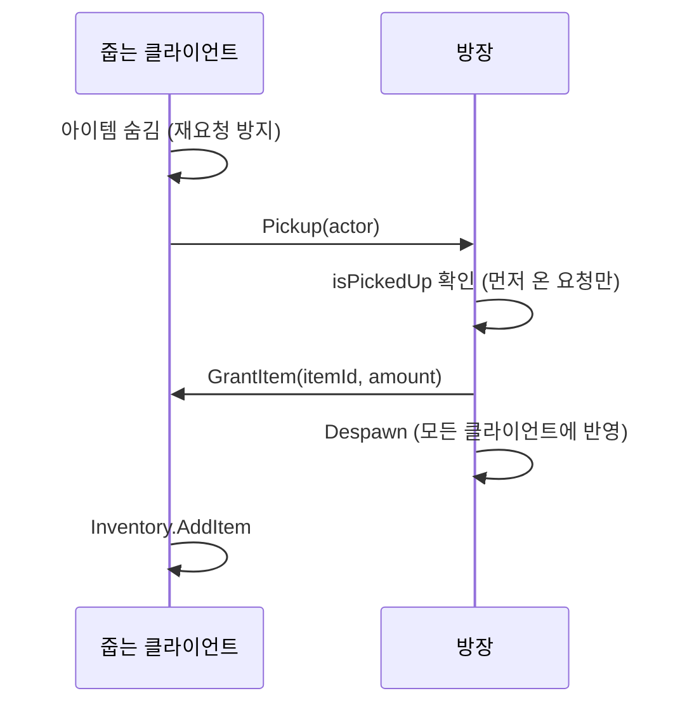

# 포트폴리오 소재 분석 (KMS 작업 기준)

> Pomunculus 프로젝트에서 `Assets/KMS/`에 작업한 내용 중, 게임 개발자 포트폴리오에 쓸 만한 소재를 골라 정리한 문서입니다.
> - **1장**: 한눈에 보기 (담당 범위, 기술 스택, 규모)
> - **2장**: 추천 소재와 우선순위
> - **3장**: 소재별 상세 (문제 → 판단 → 해결 → 결과, 보여 줄 코드, 필요한 시각 자료)
> - **4장**: 트러블슈팅 모음
> - **5장**: 협업 면에서 쓸 수 있는 내용
> - **6장**: 포트폴리오에 넣기 전에 보완할 것
> - **7장**: 직접 채워야 하는 내용
> - **8장**: 이력서용 요약 문장 예시
>
> 기준: 2026-11-13, `feat/kwon/player` 브랜치 (커밋 `6f64cf1` + 커밋 전 작업 트리)
> 근거: `Assets/KMS/Scripts/` 코드, 본인 커밋 이력, `KMS/Docs/`의 개발 기록 3편과 가이드 1편

---

## 1. 한눈에 보기

### 담당 범위
| 영역 | 내용 |
|---|---|
| 플레이어 행동 | 클릭 이동, 포션 던지기, 회피, 피격·넉백, 사망·부활, 상호작용 (FSM 6개 상태) |
| 포션 투척 | 포물선 계산, 투사체, 범위 판정, 조준선(궤적·착탄 범위) 미리보기 |
| 포션 효과 | 피해·회복·상태이상 효과를 데이터로 조합하는 구조, 인스펙터 확장 |
| 플레이어 HUD | 체력·스태미나, 상태이상 아이콘, 포션 퀵슬롯 (MVP 구조) |
| 멀티플레이 연동 | 던지기·HP·아이템 획득·장착 상태 동기화, 저장/불러오기 |
| 아이템 | 자동 줍기, 포션 프리팹 구조(Base / Thrown / Pickup 베리언트) |

### 기술 스택
| 항목 | 값 |
|---|---|
| 엔진 | Unity 6 (6000.3.6f1), URP 17.3 |
| 네트워크 | Photon PUN 2 + 팀 자체 월드 동기화 계층 (`IWorldObj`, `IWorldRPC`, `PacketData`) |
| 입력 | Input System 1.18 (`PlayerControls.inputactions`) |
| 이동 | AI Navigation 2.0.9 (NavMeshAgent) |
| 언어 | C# |

### 규모 (본인 작업)
| 항목 | 값 |
|---|---|
| 기간 | 2026-11-02 ~ 진행 중 (커밋 기준 11일) |
| 커밋 | 머지 제외 74개 (제목 중복 제외 65개: Feat 23, Update 16, Fix 12, Chore 7, Refactor 5 외) |
| 스크립트 | 44개, 약 2,900줄 (`AgentCodeGUI` 제외) |
| 문서 | 개발 기록 3편, 가이드 1편 |

### 내 작업과 팀원 작업의 경계
포트폴리오에서는 **직접 만든 것과 가져다 쓴 것을 구분**해서 써야 한다. 면접에서 가장 먼저 확인하는 부분이다.

| 구분 | 내용 |
|---|---|
| 직접 설계·구현 | `KMS/Scripts/` 전체 (플레이어 FSM과 컴포넌트, 투사체, 조준선, 포션 효과, HUD, 줍기) |
| 팀원이 만든 기반 위에 연동 | 네트워크 계층(`WorldManager`, `IWorldRPC`, `PacketData`, `WorldTransformSync`), `Entity` / `EntityDataSO`, 상태이상 시스템, `Inventory`, `PotionData` |
| 팀원 코드를 수정한 부분 | `MaterialPickup`(줍기 요청 RPC), `PotionSlotSelector` 축소, `LocalPlayerUIBinder`, `Entity.TakeDamage` virtual 전환 등 |

- `Assets/KMS/AgentCodeGUI/`는 git에서 제외된 로컬 도구라 프로젝트 결과물이 아니다. 포트폴리오에 넣지 않는다.

---

## 2. 추천 소재와 우선순위

| 순위 | 소재 | 한 줄 요약 | 강점 | 기존 문서 |
|---|---|---|---|---|
| 1 | **조준선과 실제 궤적 불일치 해결** | 원인을 3가지로 나누고, 물리 적분 오차를 수식으로 찾아 보정 | 원인 분석 과정과 수치 근거가 있다 | `ThrowAimIndicatorDevLog.md` |
| 2 | **멀티플레이 권한 구조** | "누가 결정하는가"를 정하고 요청 → 확정 → 동기화로 통일 | 실제 버그 2건의 원인과 해결이 있다 | 없음 (3장 C에 정리) |
| 3 | **플레이어 FSM과 컴포넌트 분리** | 389줄 단일 클래스 → 역할별 컴포넌트 + 제네릭 상태 머신 | 구조가 바뀐 과정을 단계별로 보여 줄 수 있다 | `PlayerBehaviorDevLog.md` |
| 4 | **포션 슬롯 UI MVP 리팩토링** | 두 곳에 있던 데이터를 한 곳으로, 매 프레임 복사 제거 | 리팩토링 전후 비교가 뚜렷하다 | `PotionSlotMVPRefactorDevLog.md` |
| 5 | **데이터로 조합하는 포션 효과** | `SerializeReference` + 커스텀 인스펙터로 효과를 코드 수정 없이 조합 | 기획자 작업 흐름을 고려한 설계 | 없음 (3장 E에 정리) |
| 6 | **조작감 (입력 버퍼·캔슬)** | 선입력, 후딜레이 캔슬, 이동 명령 보존 | 플레이 영상으로 보여 주기 좋다 | `PlayerBehaviorDevLog.md` 일부 |
| 보조 | 프리팹 베리언트, 아웃라인 셰이더, 감지 최적화, 상태이상 HUD | 짧은 항목으로 묶어서 소개 | | `PotionPrefabVariant.md` 등 |

### 권장 구성
- **메인 2~3개**: 1번(문제 해결력), 2번(네트워크 이해), 3번 또는 4번(설계·리팩토링) 가운데 고른다.
- **나머지는 "기타 구현"으로 한두 줄씩** 묶는다. 전부 길게 쓰면 핵심이 흐려진다.
- 클라이언트 직군 지원이면 1·3·6번, 멀티플레이 경험을 강조하려면 2번을 앞에 둔다.

---

## 3. 소재별 상세

## A. 조준선과 실제 궤적 불일치 해결

### 문제
Shift를 누르면 포션 궤적과 착탄 범위를 미리 보여 준다. 그런데 조준선과 실제 포션이 **조금씩** 어긋났다. 항상 같은 방향으로 어긋나지도 않았다.

### 판단
"살짝 다르다"를 한 가지 문제로 보지 않고, **증상으로 구분되는 원인 후보**로 나눴다.

| 원인 | 증상 | 구분 방법 |
|---|---|---|
| 발사 위치가 애니메이션 본 | 출발점부터 벌어짐 | 옆쪽을 조준할수록 심함 |
| 물리 적분 오차 | 방향은 맞는데 항상 조금 짧게 떨어짐 | 멀리 던질수록 심함 |
| 충돌 판정 방식 차이 | 벽 모서리를 스칠 때만 다름 | 장애물이 있을 때만 발생 |

### 해결
| 단계 | 내용 | 근거 |
|---|---|---|
| 같은 계산 재사용 | 조준선이 실제 던지기와 같은 함수(`ClampToThrowRange` → `GetThrowOrigin` → `CalculateLaunchVelocity`)를 호출 | 공식을 따로 만들면 둘이 어긋난다 |
| 적분 오차 보정 | 발사 속도에서 반 스텝만큼의 중력을 뺌 | Rigidbody는 속도를 먼저 갱신하고 위치를 옮긴다(semi-implicit Euler). 그래서 공식보다 `½·g·dt·t`만큼 낮다. 체공 1.5초에 약 15cm |
| 콜라이더를 구로 교체 | BoxCollider → SphereCollider | 랜덤 회전을 주므로 박스는 회전에 따라 닿는 범위가 달라진다 |
| 같은 크기로 검사 | 조준선 검사를 `Linecast` → `SphereCast`로 변경 | 선은 두께가 0이고, 실제 포션은 반지름 0.15인 구다 |
| 피벗 맞춤 | Thrown 베리언트에서만 콜라이더 중심을 피벗에 맞춤 | 병 모델의 피벗이 바닥이라 충돌 구가 13cm 위를 날았다 |

```csharp
// PlayerThrower.ThrowProjectile — 실제 발사에만 넣는 보정
Vector3 velocity = CalculateLaunchVelocity(origin, target, out _, out Vector3 gravity);
velocity -= 0.5f * Time.fixedDeltaTime * gravity;   // 물리 스텝의 적분 오차 보정
```

### 함께 쓸 수 있는 내용: 궤적 모양은 그대로, 빠르기만 조절
`flightSpeedMultiplier`는 **속도를 m배, 중력을 m²배** 해서 같은 포물선을 더 빠르게 지나가게 한다. 기획자가 궤적을 다시 맞추지 않고 속도감만 조절할 수 있다. 투사체마다 중력이 다르므로 `useGravity`를 끄고 `FixedUpdate`에서 직접 가속도를 준다.

### 결과
- 조준선과 실제 착탄 지점이 일치한다.
- 새 포션을 만들 때 지킬 체크리스트(구 콜라이더, Thrown 중심 맞춤)를 문서로 남겼다.

### 보여 줄 자료
| 자료 | 내용 |
|---|---|
| 전후 비교 GIF | 수정 전(어긋남) / 수정 후(일치). 벽 모서리 상황을 포함한다 |
| 수식 그림 | 해석해와 고정 스텝 적분의 차이 `½·g·dt·t` |
| 코드 | `PlayerThrower.CalculateLaunchVelocity`, `ThrowAimIndicator.DrawTrajectory` |

> 수정 전 영상이 없으면 보정 코드를 잠시 끄고 찍으면 된다. `ParabolaTestScene`을 쓰면 찍기 쉽다.

---

## B. 플레이어 FSM과 컴포넌트 분리

### 문제
처음에는 `bool isMoving` 하나로 상태를 표현했다. FSM을 도입한 뒤에는 FSM 소유자 클래스(389줄)에 입력·이동·던지기·체력·애니메이션이 모두 들어 있었다.

### 판단
- 행동이 서로 배타적이고 상태마다 시간 구간(발사 시점, 캔슬 시점, 무적 시간)이 있으므로 FSM이 맞다.
- 클래스는 **"바뀌는 이유"가 같은 것끼리** 묶는다.

### 해결
| 구성 | 내용 |
|---|---|
| `StateMachine<TEnum, TOwner>` | 제네릭 상태 머신. 플레이어에 묶이지 않아 다른 대상에도 쓸 수 있다 |
| `ValidateAllRegistered()` | enum 값에 대응하는 상태가 빠지면 시작할 때 에러로 알린다 |
| `ChangeState(next, allowReenter)` | 같은 상태 재진입으로 연속 던지기와 연속 피격을 처리한다 |
| 컴포넌트 분리 | `PlayerInputReader` / `PlayerMotor` / `PlayerThrower` / `PlayerInteractor` / `PlayerStats` |
| 데이터 분리 | `PlayerDataSO`(밸런스 값) / `PlayerTuningSO`(조작감 값) / `PlayerStats`(런타임 값) |

지킨 규칙은 세 가지다.
1. **상태 전환은 상태 클래스만 한다.** 다른 컴포넌트는 기능을 제공하거나 이벤트로 알린다.
2. **컴포넌트끼리 서로 참조하지 않는다.** `PlayerFSM`을 통해서만 접근한다.
3. **실행 순서는 `PlayerFSM.Update`가 정한다.** 컴포넌트는 자체 `Update`를 두지 않는다.

```csharp
Input.ReadInput();                    // 1. 입력 기록
fsm.Update();                         // 2. 현재 상태 실행 (입력 소비, 전환)
Stats.Tick(Time.deltaTime);           // 3. 스태미나 회복
Motor.SetMoveSpeed(Stats.MoveSpeed);  // 4. 상태이상 반영 이동속도 적용
```

### 결과
- FSM 소유자 클래스가 389줄 → 172줄로 줄었다 (분리 직후 기준).
- 이후 기능 추가(상호작용, Input System 에셋 전환, 도착 지점 감속 수정)가 해당 컴포넌트 안에서 끝났다.
- 팀 공통 `Entity` 규정이 정해졌을 때, 자체 `Health` 컴포넌트를 걷어내고 `Entity` 상속으로 바꾸는 작업이 FSM 한 곳의 수정으로 끝났다.
- 상태이상 시스템은 `Entity`의 비율·플래그(`MoveSpeedRatio`, `CanAttack` 등)만 바꾼다. 플레이어 내부 구조를 몰라도 된다.

### 보여 줄 자료
| 자료 | 내용 |
|---|---|
| 상태 전이도 | `PlayerBehaviorDevLog.md`의 mermaid 다이어그램을 그림으로 변환 |
| 구조 변화 그림 | 1단계(단일 클래스) → 3단계(컴포넌트 분리) → 8단계(스탯·SO 분리) |
| 코드 | `StateMachine.cs` 전체(61줄), `PlayerAttackState` |

> **주의**: 지금의 `PlayerFSM`은 네트워크 RPC와 저장/불러오기가 붙어 474줄이다. "172줄로 줄였다"만 쓰면 현재 코드와 맞지 않는다. 6장의 보완 항목을 참고한다.

---

## C. 멀티플레이 권한 구조

팀의 네트워크 계층(`IWorldRPC`, `PacketData`) 위에서 플레이어 쪽 동기화를 구현했다. 계층 자체는 팀원이 만들었고, **무엇을 누가 결정하고 무엇을 보낼지**를 설계한 부분이 본인 작업이다.

### 원칙: 대상마다 결정권자가 하나
| 대상 | 결정권자 | 다른 클라이언트가 하는 일 |
|---|---|---|
| 플레이어의 HP·사망·상태 | 그 플레이어의 소유자 | 피해·회복을 **요청**만 한다 |
| 적 | 방장 | 연출만 한다 |
| 필드 아이템 | 방장 | 줍기를 **요청**만 한다 |

### 적용 1 — 던지기 동기화
- 소유자가 발사 위치·초기 속도·중력·포션 Id를 계산해서 모든 클라이언트에 보낸다.
- 각 클라이언트는 받은 값으로 **같은 궤적을 로컬에서 시뮬레이션**한다. 투사체 위치를 매 프레임 보내지 않는다.
- 착탄 판정은 모든 화면에서 일어나지만, **효과는 대상의 결정권자 화면에서만 적용**한다.

```csharp
// ThrownProjectile — 이 클라이언트가 대상의 결정권자인지 확인한다 (적 = 방장, 플레이어 = 본인)
bool HasAuthority(Entity entity)
{
    if (!PhotonNetwork.InRoom) return true;
    if (entity is PlayerFSM player) return player.IsMine;
    return PhotonNetwork.IsMasterClient;
}
```

### 적용 2 — 피해·회복 요청
```
다른 화면에서 맞음 → RequestDamage (소유자에게만) → 소유자가 무적·피해 비율 적용 후 확정 → SyncHp (나머지에게)
```
무적 판정(회피 초반, 사망)은 소유자 화면의 상태가 기준이다. 복사본은 늦을 수 있어서 판단하지 않는다.

### 적용 3 — 아이템 줍기 (버그 수정)
| 항목 | 내용 |
|---|---|
| 증상 | 방장이 아닌 플레이어가 재료를 줍지 못했다 |
| 원인 | 월드에 등록된 오브젝트는 방장만 지울 수 있었다. 줍는 쪽에서 직접 지우려다가 조건에 걸려 그냥 반환했다 |
| 해결 | 줍는 쪽은 방장에게 요청만 한다. 방장이 **먼저 온 요청 하나만** 확정하고(`isPickedUp`), 그 플레이어의 소유자에게만 지급 RPC를 보낸 뒤 오브젝트를 제거한다 |
| 효과 | 두 명이 동시에 주워도 중복 지급되지 않는다 |



### 적용 4 — 다른 플레이어가 나가면 조작 불가 (버그 수정)
| 항목 | 내용 |
|---|---|
| 증상 | 멀티 중 다른 플레이어가 나가면, 남은 플레이어가 아무 조작도 할 수 없었다 |
| 원인 | 모든 플레이어 인스턴스가 **같은 `InputActionAsset` 에셋**을 참조했다. 나간 플레이어의 `PlayerInputReader.OnDisable`이 공유 에셋의 액션 맵을 꺼서 내 입력도 꺼졌다 |
| 해결 | `Awake`에서 `Instantiate(controls)`로 인스턴스마다 복제하고 `OnDestroy`에서 정리했다 (8줄 수정) |

> 원인은 수정 커밋(`0efc783`)과 코드에서 읽은 내용이다. 실제로 디버깅한 과정(어떻게 원인을 좁혔는지)을 덧붙이면 훨씬 좋은 소재가 된다.

### 그 밖의 연동
- **HUD**: `LocalPlayerHUD`가 `IsMine`인 플레이어에만 HUD를 생성한다. 소유자는 생성 직후에 정해지므로 `Awake`가 아니라 `Start`에서 판정한다.
- **저장/불러오기**: `PlayerWorldData`에 HP·스태미나·인벤토리·포션 장착 상태를 담는다. (포션 장착 저장과 `SyncLoadout` RPC는 커밋 전 작업 트리에 있다.)

### 보여 줄 자료
| 자료 | 내용 |
|---|---|
| 2인 플레이 영상 | 화면 두 개를 나란히. 던지기, 피격, 아이템 줍기 |
| 흐름도 | 위 시퀀스 다이어그램, 피해 요청 흐름 |
| 코드 | `PlayerFSM`의 RPC 영역, `ThrownProjectile.HasAuthority`, `MaterialPickup.HandlePickupRequest` |

### 면접 대비
| 예상 질문 | 답변 방향 |
|---|---|
| 소유자가 HP를 결정하면 조작이 가능하지 않나? | 협동 게임이라 반응성을 우선했다. 경쟁 게임이면 방장(또는 서버) 판정으로 옮겨야 한다 |
| 클라이언트마다 물리 결과가 다르면? | 궤적은 같은 초기값이라 거의 같다. 효과는 결정권자 화면에서만 적용하므로 결과가 갈리지 않는다. 다만 연출 위치는 조금 다를 수 있다 |
| 줍기 요청 후 방장이 응답하기 전에 나가면? | 줍는 쪽은 이미 아이템을 숨겼다. 방장이 바뀌었을 때 복구하는 처리는 아직 없다 (보완 대상) |

---

## D. 포션 슬롯 UI MVP 리팩토링

### 문제
| 문제 | 내용 |
|---|---|
| 데이터가 두 곳 | 인벤토리 UI(`PotionSlotSelector`)와 플레이어(`PotionLoadout`)가 장착 정보를 따로 가졌다 |
| 매 프레임 복사 | 변경 이벤트가 없어서 `PotionLoadoutSync`가 `LateUpdate`마다 비교하고 복사했다 |
| 그리는 경로가 두 개, 입력 중복 | 같은 슬롯을 두 곳에서 그리고, 숫자키를 두 곳에서 처리했다 |
| 저장 불가 | 장착 정보가 씬의 UI에 있어 플레이어 저장 데이터에 넣을 수 없었다. 불러와도 다음 프레임에 UI 값으로 덮어써졌다 |

### 해결
- **Model은 `PotionLoadout` 하나**. 장착 슬롯, 선택 슬롯, 장착 대기 상태를 가지고 변경 이벤트 3개를 낸다.
- **View**는 받은 값을 표시하고 "몇 번 버튼이 눌렸다"만 알린다. **Presenter**가 Model과 Inventory 이벤트를 View에 연결한다.
- 동기화 컴포넌트 `PotionLoadoutSync`를 **삭제**했다.
- 팀원 담당 코드(`PotionSlotSelector`)는 없애지 않고 역할만 줄였다. 다른 팀원 코드가 계속 같은 메서드를 호출하면 되므로 수정 범위가 작다.

### 결과
- 매 프레임 비교·복사가 사라지고 이벤트가 있을 때만 갱신한다.
- 장착 상태를 저장하고 네트워크로 보낼 수 있게 됐다 (`Loadout.Restore`).
- HUD가 늦게 연결돼도 Presenter의 첫 갱신이 Model 값을 그대로 읽으므로 순서와 상관없다.

### 같이 쓸 수 있는 디버깅 사례
**게임 시작 직후 선택 프레임이 엉뚱한 위치에 표시됨**
1. HUD를 생성한 프레임에 바로 슬롯 위치를 읽어 프레임을 옮겼다.
2. `GridLayoutGroup`은 그 프레임의 렌더링 직전에야 자식을 배치한다. 그 전에는 세 슬롯이 모두 같은 위치에 겹쳐 있다.
3. 초기 선택값이 0이라 1번 키를 눌러도 이벤트가 나지 않아 바로잡히지도 않았다.
4. 위치를 계산하지 않고 **프레임을 선택된 셀의 자식으로 붙이는 방식**으로 바꿨다. 레이아웃 시점이나 해상도와 상관없다.

### 보여 줄 자료
| 자료 | 내용 |
|---|---|
| 전후 구조 그림 | 리팩토링 전(양쪽 보관 + Sync) / 후(Model 하나) |
| 플레이 GIF | 인벤토리에서 포션 클릭 → HUD에 + 표시 → 장착 → 수량 갱신 |
| 코드 | `PotionLoadout`, `PotionSlotPresenter`, `IPotionSlotView` |

---

## E. 데이터로 조합하는 포션 효과

### 구조
| 구성 | 내용 |
|---|---|
| `PotionEffect` (추상 클래스) | 효과 하나. `CanAffect(관계)`와 `Apply(context)` |
| `DamagePotionEffect` / `HealPotionEffect` / `StatusPotionEffect` | 피해 / 회복 / 상태이상 |
| `PotionTargetFlags` (`[Flags]`) | 효과마다 적용 대상을 정한다 (아군 / 적 / 모두) |
| `PotionHitContext` (`readonly struct`, `in` 전달) | 착탄 정보를 묶어서 복사 없이 넘긴다 |
| `PotionData.effects` (`[SerializeReference]`) | 서로 다른 효과 타입을 한 리스트에 저장한다 |
| `PotionDataEditor` | 인스펙터에 "효과 추가" 버튼. `TypeCache`로 `PotionEffect` 하위 클래스를 찾아 메뉴로 보여 준다 |
| `PotionDatabase` | Id → `PotionData` 조회. 네트워크와 저장에는 Id만 보낸다 |

### 쓸 만한 내용
- **새 효과를 추가할 때 고칠 곳이 클래스 하나**다. 에디터 메뉴는 `TypeCache`가 자동으로 찾으므로 건드리지 않는다.
- "적에게 피해 + 아군에게 회복"처럼 **한 포션에 대상이 다른 효과를 섞을 수 있다**.
- `SerializeReference` 리스트는 크기만 늘리면 **이전 원소와 같은 참조를 복사**한다. 그래서 새 객체를 만들어 덮어쓴다.

```csharp
effects.arraySize++;
// 크기만 늘리면 이전 원소를 같은 참조로 복사하므로 반드시 새 객체로 덮어쓴다
effects.GetArrayElementAtIndex(effects.arraySize - 1).managedReferenceValue = Activator.CreateInstance(type);
```

### 보여 줄 자료
- 인스펙터에서 "효과 추가" 메뉴를 여는 GIF
- 화염 포션 데이터 화면 (피해 + 화상)

---

## F. 조작감: 입력 버퍼와 캔슬

| 기능 | 내용 | 위치 |
|---|---|---|
| 선입력 | 좌클릭·Space·G를 0.15초 동안 버퍼에 남긴다. 조금 일찍 눌러도 행동이 끝나면 이어진다 | `PlayerInputReader.Consume*` |
| 이동 명령 보존 | 던지기·피격 중에 누른 우클릭은 소비될 때까지 남는다 | `ConsumeMoveCommand` |
| 쿨다운 중 입력 보존 | 회피 쿨다운이면 입력을 소비하지 않고 버퍼에 둔다 | `PlayerFSM.ConsumeDodge` |
| 후딜레이 캔슬 | 던진 뒤 캔슬 구간부터 회피 / 연속 던지기 / 이동으로 끊을 수 있다 | `PlayerAttackState` |
| 홀드 이동 | 우클릭을 누르고 있으면 0.1초마다 목적지를 갱신한다 | `ReadInput` |
| UI 클릭 구분 | 커서가 UI 위에 있으면 던지지 않는다 | `IsPointerOverUI` |
| 무적 구간 | 회피 초반만 무적. 상태가 직접 답한다 | `PlayerDodgeState.IsInvincible` |
| 넉백 | 맞은 방향 반대로 밀리고 경직 동안 점점 느려진다. NavMesh 밖으로는 밀리지 않는다 | `PlayerHitState`, `PlayerMotor.Displace` |

핵심은 **입력은 기록만 하고, 행동은 상태가 꺼낼 때 일어난다**는 구조다. 이 구조 덕분에 위 기능들이 상태 코드 몇 줄로 끝난다.

- 자료: 연속 던지기, 던지고 바로 회피, 피격 중 누른 이동이 경직 뒤 실행되는 장면을 담은 GIF

---

## G. 보조 소재 (짧게 묶어서)

| 소재 | 내용 | 위치 |
|---|---|---|
| 포션 프리팹 베리언트 | Base(모양·물리) → Thrown / Pickup으로 나눔. 한 프리팹에 두 동작을 넣었을 때의 문제(꺼진 컴포넌트에도 `OnCollisionEnter` 호출, 던지자마자 다시 줍기)를 구조로 없앴다 | `PotionPrefabVariant.md` |
| 상호작용 아웃라인 셰이더 | Inverted Hull 방식. 두께를 화면 공간 픽셀 단위로 계산해 카메라 거리와 상관없이 일정하다. 각진 메시용 "중심에서 부풀리기" 옵션 | `InteractOutline.shader` |
| 하이라이트 적용 | `sharedMaterials`에 아웃라인 머티리얼만 덧붙였다 뺀다. 머티리얼 복제본이 생기지 않고, 하이라이트 중에 대상이 머티리얼을 바꿔도 안전하다 | `InteractHighlighter` |
| 주변 감지 | `OverlapSphereNonAlloc` + 고정 버퍼 + 0.1초 간격 스캔. 매 프레임 할당이 없다 | `PlayerInteractor`, `ItemPickupController` |
| 파괴된 대상 처리 | 인터페이스 참조는 Unity의 파괴 확인(`== null`)이 안 되므로 `Component`를 함께 보관한다 | `PlayerInteractor.Current` |
| 스태미나 | 소모 후 회복 지연, 정수 스태미나에 소수점 회복량 누적, 지연이 끝난 프레임의 남은 시간까지 반영 | `PlayerStats.Tick` |
| 상태이상 HUD | 이벤트로 아이콘 추가·갱신·제거. 남은 초 텍스트는 값이 바뀔 때만 갱신. 늦게 연결돼도 이미 걸린 상태를 표시 | `StatusPanelPresenter`, `StatusEffectIconView` |
| 에디터 자동화 | 실행 중인 에디터에 C#을 보내 프리팹을 일괄 수정 (`PrefabUtility.LoadPrefabContents`) | 개발 기록 2편 |

---

## 4. 트러블슈팅 모음

포트폴리오의 "문제 해결" 항목에 표로 넣기 좋은 것들이다.

| # | 증상 | 원인 | 해결 |
|---|---|---|---|
| 1 | 조준선보다 포션이 짧게 떨어짐 | 고정 스텝 적분 오차 `½·g·dt·t` | 발사 속도에서 반 스텝 중력 보정 |
| 2 | 같은 곳을 조준해도 착탄이 매번 다름 | 랜덤 회전 + BoxCollider | SphereCollider로 교체 |
| 3 | 조준선은 벽을 넘는데 포션은 걸림 | 두께 0인 선 검사, 콜라이더 중심이 피벗보다 13cm 위 | `SphereCast` + 중심을 피벗에 맞춤 |
| 4 | 다른 플레이어가 나가면 조작 불가 | 입력 에셋을 모든 인스턴스가 공유 | 인스턴스마다 복제 |
| 5 | 방장 외에는 재료를 못 주움 | 방장만 월드 오브젝트를 지울 수 있음 | 요청 → 방장 확정 → 지급 RPC |
| 6 | 바닥의 병이 닿자마자 사라짐 | 꺼진 컴포넌트에도 `OnCollisionEnter`가 호출됨 | 프리팹 베리언트로 동작 분리 |
| 7 | 선택 프레임이 시작 직후 엉뚱한 위치 | `GridLayoutGroup` 배치 전에 위치를 읽음 | 프레임을 셀의 자식으로 붙임 |
| 8 | 어느 + 버튼을 눌러도 같은 슬롯 | 람다가 반복 변수 `i`를 캡처 | 지역 변수로 복사 |
| 9 | 필드명을 바꾼 뒤 버튼이 동작하지 않음 | 직렬화된 연결이 끊김 | 다시 연결 (`FormerlySerializedAs`) |
| 10 | 선택된 슬롯의 +만 안 눌림 | 프레임 이미지가 클릭을 가로챔 | Raycast Target 끔 + 그리는 순서 변경 |
| 11 | 도착 지점 근처에서 느려짐 | NavMeshAgent `autoBraking` | 끄고 `PlayerMotor`에서 도착 처리 |
| 12 | 불러온 장착 정보가 사라짐 | 단방향 동기화가 다음 프레임에 덮어씀 | Model을 하나로 합치고 동기화 컴포넌트 삭제 |

- 1~5번은 원인 분석 과정이 있어 **자세히 풀어 쓸 만하다**.
- 6~12번은 표 한 줄씩으로 충분하다.

---

## 5. 협업 면에서 쓸 수 있는 내용

| 내용 | 근거 |
|---|---|
| 팀 공통 규정에 맞춰 자기 코드를 바꿈 | 자체 `Health` → 팀 `Entity` 상속으로 전환 (`PlayerBehaviorDevLog.md` 7단계) |
| 다른 팀원 시스템과의 접점을 좁게 유지 | 상태이상은 `Entity` 값만, HUD는 `PlayerStats` 이벤트 2개만 구독 |
| 팀원 담당 코드를 수정할 때 범위를 줄임 | `PotionSlotSelector`를 남겨 다른 팀원 코드의 호출부를 그대로 유지. 지운 코드는 사유 주석으로 남기고 머지 전에 공유 |
| 결정 이유를 문서로 남김 | 개발 기록 3편 (문제 → 원인 → 해결, 남은 작업까지) |
| 다른 사람이 따라 할 수 있는 가이드 작성 | `PotionPrefabVariant.md` (새 포션 추가 절차, 이름 규칙) |
| 커밋 규칙, PR 기반 작업 | `[Feat]` / `[Fix]` / `[Refactor]` 접두사, 기능 브랜치 → PR |
| 테스트 환경을 직접 구성 | `PlayerTestScene`(NavMesh 미로), `ParabolaTestScene`(궤적 확인), 에디터 전용 디버그 키(H 피해, R 부활) |

---

## 6. 포트폴리오에 넣기 전에 보완할 것

코드 저장소를 공개하거나 면접에서 코드를 열어 보게 되면 바로 보이는 부분들이다.

### 코드 정리
| 항목 | 위치 | 조치 |
|---|---|---|
| 팀 컨벤션과 다른 `public` 설정 필드 | `PlayerInputReader`, `PlayerInteractor`, `ItemPickupController`, `ThrownProjectile`, `InteractHighlighter` | `[SerializeField] private`으로 변경 (`FormerlySerializedAs` 필요) |
| 쓰지 않는 메서드 | `ThrowAimIndicator.GetImpactRadius` | 삭제 |
| 중복 검사 | `PlayerFSM.ConsumeAttack`의 `hasPotion` | `AttackPotion = GetThrowablePotion();` |
| 중복 대입 | `PlayerFSM.SaveData`: `GetSlotIds()`로 채운 배열을 반복문으로 다시 채움 | 반복문 삭제 |
| 매 스캔마다 로그 출력 | `ItemPickupController.Scan`의 `Debug.Log` | 삭제 |
| 내용과 다른 주석 | `PlayerThrower`의 `FormerlySerializedAs` 주석, `StatusPanelPresenter`의 "(뼈대)"와 TODO | 수정 |
| 빈 클래스 | `PopupUI` (커밋 전) | 구현하거나 커밋에서 제외 |
| null 확인 없음 | `PotionLoadout.Restore`의 `PotionDatabase.Instance` | 확인 추가 |
| 미완성 | `StatusPanelPresenter.GetIcon`이 항상 null | 아이콘 데이터 연결 |

### 구조
| 항목 | 내용 |
|---|---|
| `PlayerFSM`이 다시 커짐 (474줄) | RPC 송수신과 저장/불러오기가 FSM에 붙었다. B의 "바뀌는 이유로 나눈다"는 원칙과 맞지 않는다. **별도 컴포넌트(예: `PlayerNetSync`)로 빼면 B 소재가 일관되고, "원칙을 다시 적용했다"는 내용이 하나 더 생긴다** |
| 줍기 타입 분기 | `ItemPickupController`가 `MaterialPickup`과 `PotionPickup`을 각각 검사한다. 코드에 TODO로 적어 둔 대로 인터페이스로 묶는다 |
| 아군·적 판정 | `ThrownProjectile.GetRelation`이 `PlayerFSM`인지로만 판단한다. 대상 종류가 늘면 확장이 필요하다 |

### 근거 자료
| 항목 | 내용 |
|---|---|
| 영상·GIF가 없음 | 3장의 "보여 줄 자료"를 먼저 만든다. 포트폴리오에서 가장 효과가 큰 부분이다 |
| 수치가 부족함 | 확인된 수치는 389줄 → 172줄, 오차 약 15cm, 중심 오프셋 13cm 정도다. 프로파일러로 리팩토링 전후(매 프레임 복사 제거, 감지 스캔의 GC 할당)를 재면 근거가 생긴다 |
| 자동 테스트가 없음 | `StateMachine`, `PlayerStats`, `PotionLoadout`은 순수 C#에 가깝다. EditMode 테스트를 몇 개 붙이면 "테스트 가능한 구조"라는 말을 증명할 수 있다 |
| 문서와 코드가 어긋난 부분 | `PotionSlotMVPRefactorDevLog.md` Part 3의 "저장/불러오기 미연결"은 작업 트리에서 이미 구현됐다. `PotionPrefabVariant.md` 4장은 아직 BoxCollider를 안내한다 |

---

## 7. 직접 채워야 하는 내용

코드에서는 알 수 없어서 비워 둔 항목이다.

| 항목 | 메모 |
|---|---|
| 게임 소개 한두 문장 | 장르, 핵심 재미, 플레이 인원 |
| 팀 구성과 본인 역할 | 인원, 직군, 본인 직함 (예: 플레이어 파트 담당) |
| 전체 기간과 현재 단계 | 커밋은 2026-11-02에 시작했다. 기획 기간과 종료 예정일 |
| FSM을 고른 실제 이유 | `PlayerBehaviorDevLog.md` Part 2의 1절은 코드에서 추정한 내용이다. 실제 의도와 다르면 고친다 |
| 디버깅 과정 | 3장 C의 "나가면 조작 불가" 버그를 어떻게 찾았는지. 원인을 좁힌 과정이 소재의 핵심이다 |
| 버려진 대안 | 검토했다가 쓰지 않은 방법과 이유 (예: 투사체 위치를 매 프레임 동기화하지 않은 이유) |
| 배운 점 | 다시 한다면 다르게 할 것 |
| 플레이 영상, 빌드 링크, 저장소 공개 여부 | 팀 프로젝트이므로 공개 범위를 팀과 확인한다 |

---

## 8. 이력서용 요약 문장 예시

수치와 사실은 이 문서에서 확인한 것만 썼다. 문장은 본인 말투에 맞게 고쳐 쓴다.

- N인 팀의 협동 멀티플레이 게임에서 플레이어 조작·포션 투척·HUD를 담당 *(인원은 직접 채운다)*
- 제네릭 상태 머신과 역할별 컴포넌트 분리로 389줄 단일 클래스를 172줄로 줄이고, 이후 기능 추가를 컴포넌트 단위로 처리
- 조준선과 실제 투사체 궤적의 불일치를 원인 3가지로 나눠 분석하고, 고정 스텝 물리의 적분 오차(체공 1.5초에 약 15cm)를 수식으로 보정
- 대상별 결정권자(소유자 / 방장)를 정하고 요청 → 확정 → 동기화 흐름으로 던지기·피해·아이템 획득을 동기화. 중복 지급과 비방장 획득 불가 버그 해결
- 두 곳에 나뉘어 있던 포션 슬롯 데이터를 MVP 구조로 통합해 매 프레임 동기화 코드를 제거하고, 저장·네트워크 동기화가 가능한 구조로 변경
- `SerializeReference`와 커스텀 인스펙터로 포션 효과를 코드 수정 없이 조합하는 데이터 구조 구현
- 설계 결정과 문제 해결 과정을 개발 기록 3편과 가이드 1편으로 정리해 팀에 공유
